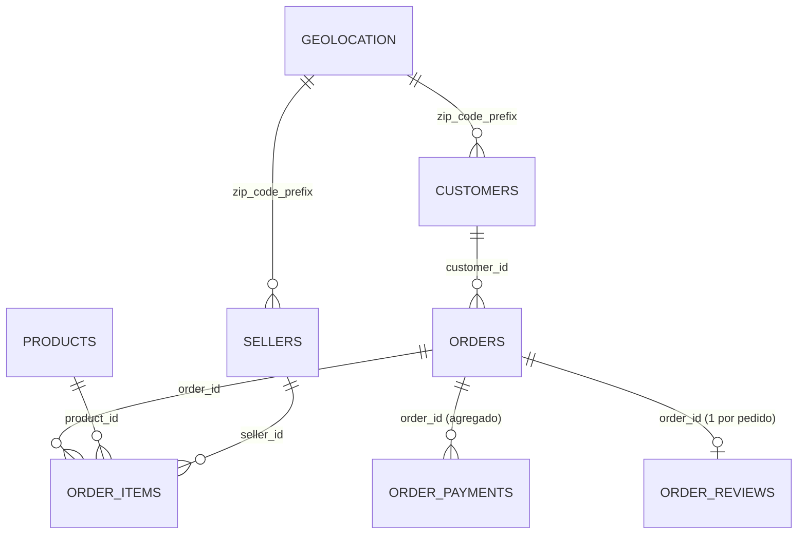

# Modelo de dados

Dois fatos (pedido e item) cercados de dimensões. Os pagamentos e as avaliações são reduzidos a uma linha por
pedido antes de entrar no modelo, para que nenhum relacionamento seja muitos-para-muitos.

## Tabelas geradas (`data/processed/`)

| Tabela | Grão | Origem |
| --- | --- | --- |
| `pedidos` | 1 linha por pedido | orders + customers + geolocation + itens agregados + pagamentos agregados + avaliação |
| `itens` | 1 linha por item | order_items + products + sellers |
| `clientes` | 1 linha por `customer_unique_id` | pedidos válidos agrupados |
| `vendedores` | 1 linha por vendedor | sellers |

## Onde cada relacionamento é usado

| Relacionamento | Uso | Páginas |
| --- | --- | --- |
| itens → pedidos | Receita mensal; filtro de categoria (pedido entra se tiver item do grupo) | todas |
| pedidos → clientes | Clientes únicos, recompra, estado e região | Visão geral, Geografia |
| pedidos → avaliações | Nota por faixa de atraso, por estado, por categoria | Logística, Produtos |
| itens → produtos | Receita e atraso por categoria | Visão geral, Produtos |
| itens → vendedores | Ranking, concentração da receita, mesmo estado ou não | Produtos, Logística |
| clientes/vendedores → geolocalização | Distância vendedor–cliente, mapa | Logística, Geografia |
| pedidos → pagamentos | Filtro de forma de pagamento, parcelamento | Produtos, filtros |

O filtro de categoria é o exemplo mais claro de relacionamento usado em tempo de execução: ele filtra a tabela de
itens e volta para os pedidos por `pedido_id` (`app/core/data.py`, função `filtrar`).
